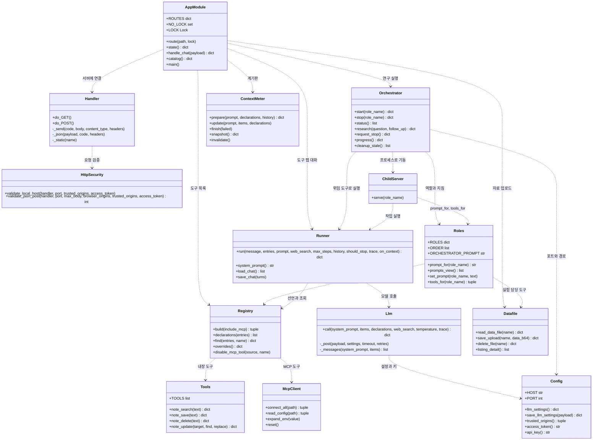
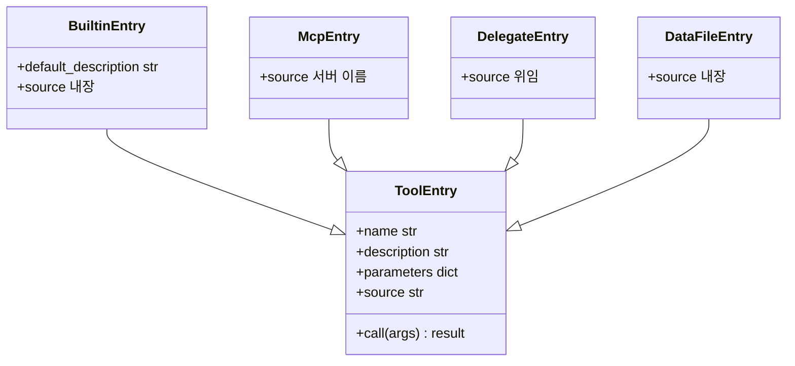
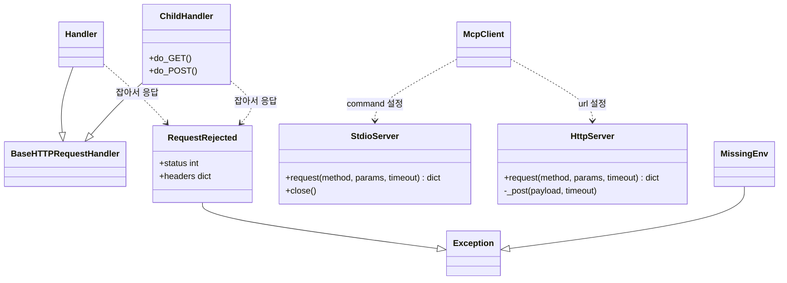
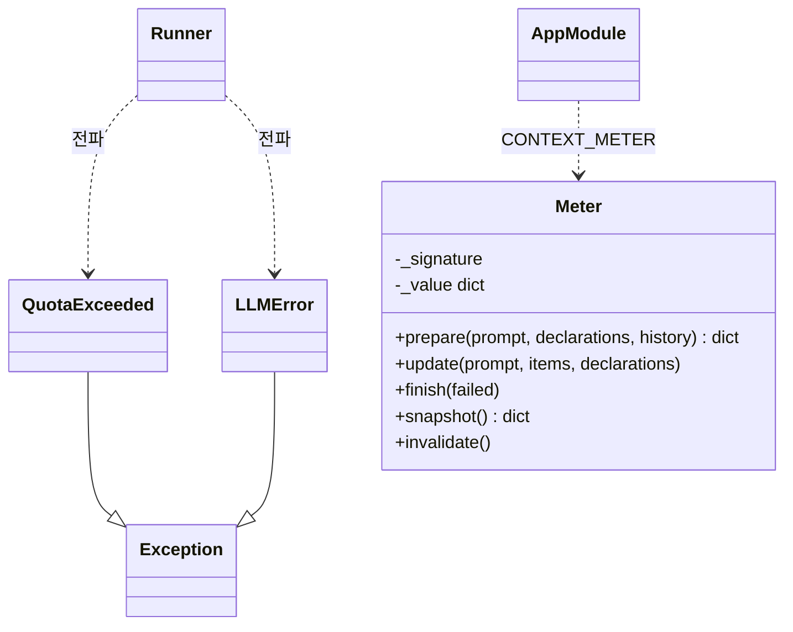

# UML 클래스 다이어그램

이 코드베이스는 클래스보다 **모듈과 함수** 중심이다. 클래스는 `Handler`, `Meter`, `StdioServer`, `HttpServer` 등 소수이고, 나머지는 모듈 수준 함수와 딕셔너리 형태의 데이터(`entry`)다. 다이어그램은 모듈을 클래스 상자로 그려 책임과 의존을 보여 준다. 데이터 모양은 [데이터 저장소 설계](database-design.md)를 본다.

## 1. 레이어 구조

`..>`는 의존(호출) 관계다. 순환 의존이 없도록 `roles`는 `datafile`/`registry`를 함수 안에서 늦게 import한다.

## 2. 도구 항목(entry) 구조

도구는 클래스가 아니라 딕셔너리다. 내장 도구, MCP 도구, 위임 도구, 연구 자료 읽기 도구가 모두 같은 모양을 쓰기 때문에 `runner.run`은 출처를 구분하지 않는다.

| 종류 | 만드는 곳 | 누가 보는가 |
|------|-----------|-------------|
| BuiltinEntry | `registry._builtin()` — `memo_tool_1~4` | 도구 탭 대화 |
| McpEntry | `mcp_client.connect_all()` | 도구 탭 대화, 자료조사 연구원 |
| DelegateEntry | `orchestrator._delegate_entries()` — `delegate_research`, `delegate_experiment` | 연구책임자만 |
| DataFileEntry | `roles.tools_for("experiment")` — `read_data_file` | 실험수행 연구원만 |

도구 경계는 코드로 강제된다. 자료조사는 MCP 도구와 웹 검색만, 실험수행은 `read_data_file`만 받는다. 내장 메모 도구는 어느 연구원에게도 주지 않는다.

## 3. HTTP 서버와 MCP 연결

## 4. 오류 타입과 계기판

- `QuotaExceeded`: HTTP 429(분당 한도 또는 잔액). 화면에는 "잠시 후 다시 시도" 문구로 바꿔 보여 준다.
- `LLMError`: 그 밖의 API·네트워크 오류. 메시지에 키를 담지 않는다. Ollama는 접두사 `network:`로 연결 실패와 거부를 구분한다.
- `Meter`: Instructions · Tools · Context 비중을 글자 수로 추정하고, 응답의 실제 사용량이 오면 그 값에 맞춰 비율을 조정한다. 저장된 대화는 서명(`prepare`의 캐시 키)에 넣지 않는다. 넣으면 대화가 끝날 때마다 실측값이 추정값으로 덮인다.
