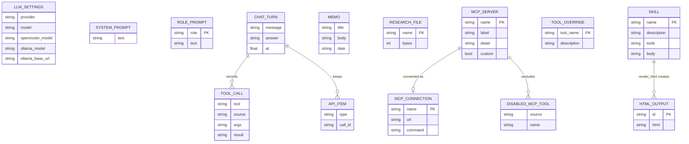
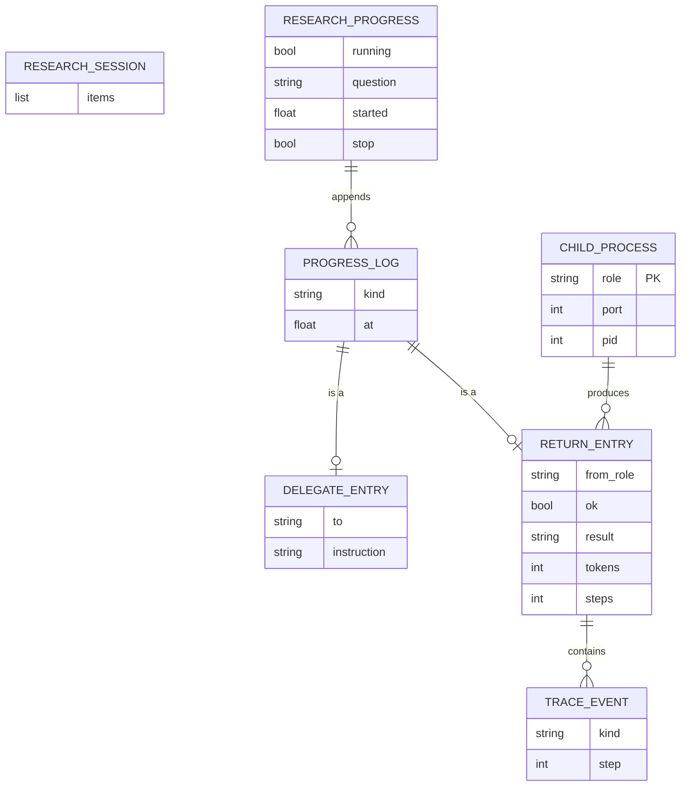

# ER 다이어그램

DB가 없으므로 이 다이어그램은 **파일에 저장되는 개체 사이의 관계**를 나타낸다. 필드 정의는 [데이터 저장소 설계](database-design.md)를 본다.

## 1. 저장소 전체

| 개체 | 저장 파일 | 비고 |
|------|-----------|------|
| LLM_SETTINGS | `state/llm_settings.json` | 항상 1건 |
| SYSTEM_PROMPT | `state/system_prompt.txt` | 0 또는 1건 |
| ROLE_PROMPT | `state/role_prompts.json` | 역할당 0 또는 1건 (`research`, `experiment`) |
| CHAT_TURN / TOOL_CALL / API_ITEM | `state/chat_history.json` | 최근 30턴 |
| MEMO | `data/notes.json` | 배열 |
| RESEARCH_FILE | `data/research/` | 폴더 안의 파일 |
| MCP_SERVER | `mcp_catalog.json` + `state/mcp_custom.json` | 두 파일을 합쳐 목록을 만든다 |
| MCP_CONNECTION | `mcp_config.json` | 켜 둔 서버만 |
| DISABLED_MCP_TOOL | `state/disabled_mcp_tools.json` | (서버, 도구) 쌍 |
| TOOL_OVERRIDE | `state/tool_overrides.json` | 화면 라우트는 현재 없음 |
| SKILL | `skills/<이름>/SKILL.md` | 화면의 스킬 카드에서 추가·수정·삭제. 코드는 담지 않는다 |
| HTML_OUTPUT | `state/outputs/<id>.html` | `render_html` 도구가 만든 문서. 최근 50개 |

관계의 의미:

- **CHAT_TURN → TOOL_CALL**: 한 턴에서 모델이 부른 도구 요약. 화면에 보인다.
- **CHAT_TURN → API_ITEM**: 같은 턴의 원본 API 항목. 다음 요청에 이어 넘기며, `function_call`과 `function_call_output`이 한 쌍이어야 하므로 턴 단위로 함께 지운다.
- **MCP_SERVER → MCP_CONNECTION**: 카탈로그의 서버 중 켠 것만 설정 파일에 들어간다. 서버 이름이 둘을 잇는 키다.
- **MCP_SERVER → DISABLED_MCP_TOOL**: 서버는 연결한 채 개별 도구만 뺄 수 있다.
- **SKILL → HTML_OUTPUT**: `tools`에 `render_html`을 가진 스킬(기본 `html`)을 모델이 읽고 도구를 부르면 문서가 한 건 생긴다. 답변에는 문서 id만 `[[html:id]]`로 남는다.

## 2. 실행 중에만 존재하는 개체 (메모리)

파일에 저장되지 않는다. 앱을 재시작하면 사라진다.

| 개체 | 위치 | 설명 |
|------|------|------|
| RESEARCH_SESSION | `orchestrator._SESSION` | 연구책임자가 기억하는 앞선 대화. 후속 질문에 쓴다 |
| RESEARCH_PROGRESS | `orchestrator._PROGRESS` | 지금 도는 연구의 상태. `/api/research/progress`가 읽는다 |
| PROGRESS_LOG | `_PROGRESS["log"]` | `delegate` · `return` · `final` 세 종류 (`kind`) |
| DELEGATE_ENTRY | 로그 항목 | 맡긴 지시문. 보내기 **전에** 남긴다 |
| RETURN_ENTRY | 로그 항목 | 돌아온 보고와 `trace`. 짝이 되는 `return`이 붙으면 그 연구원은 끝난 것 |
| TRACE_EVENT | `return.trace` | `request` · `response` · `tool` 세 종류 |
| CHILD_PROCESS | `orchestrator._CHILDREN` | `research:8771`, `experiment:8772` |
