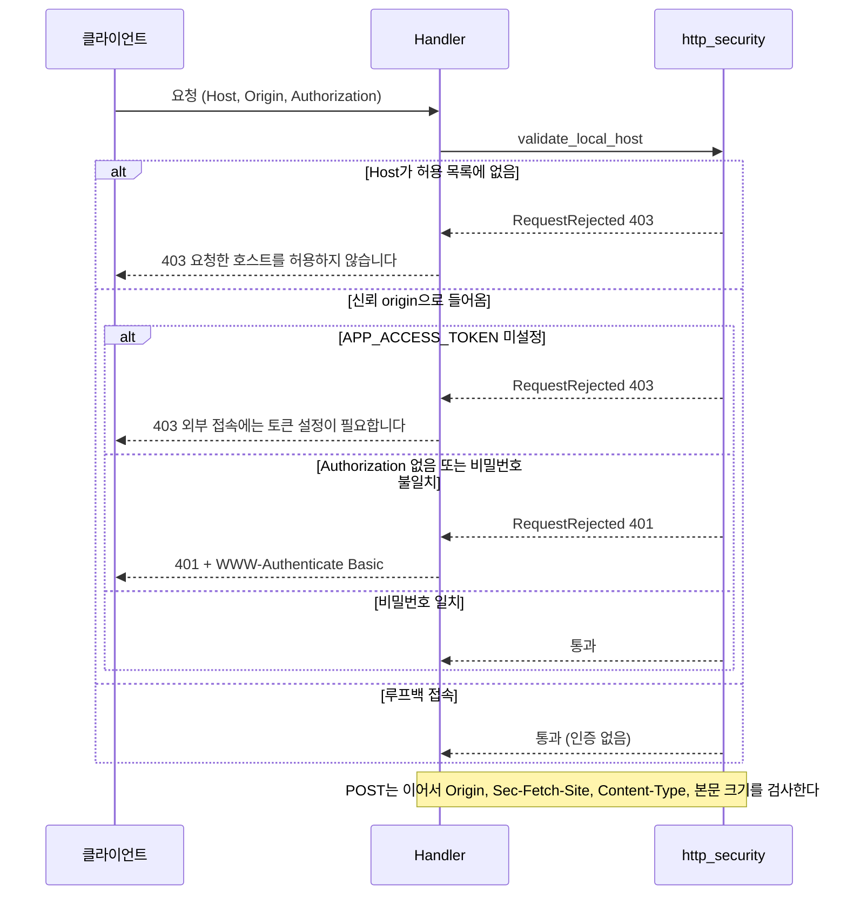
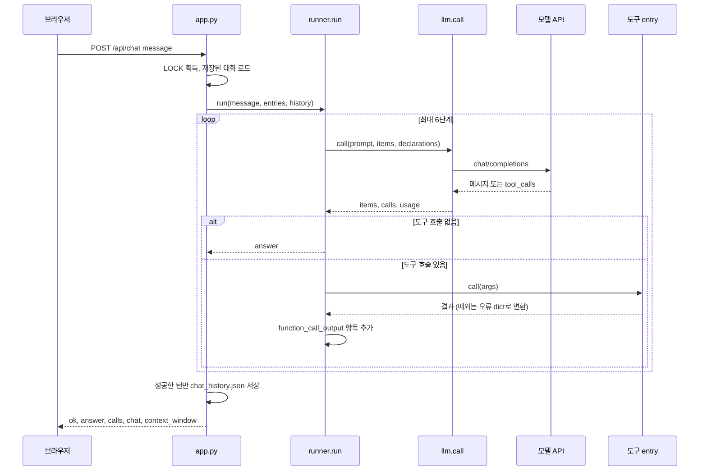
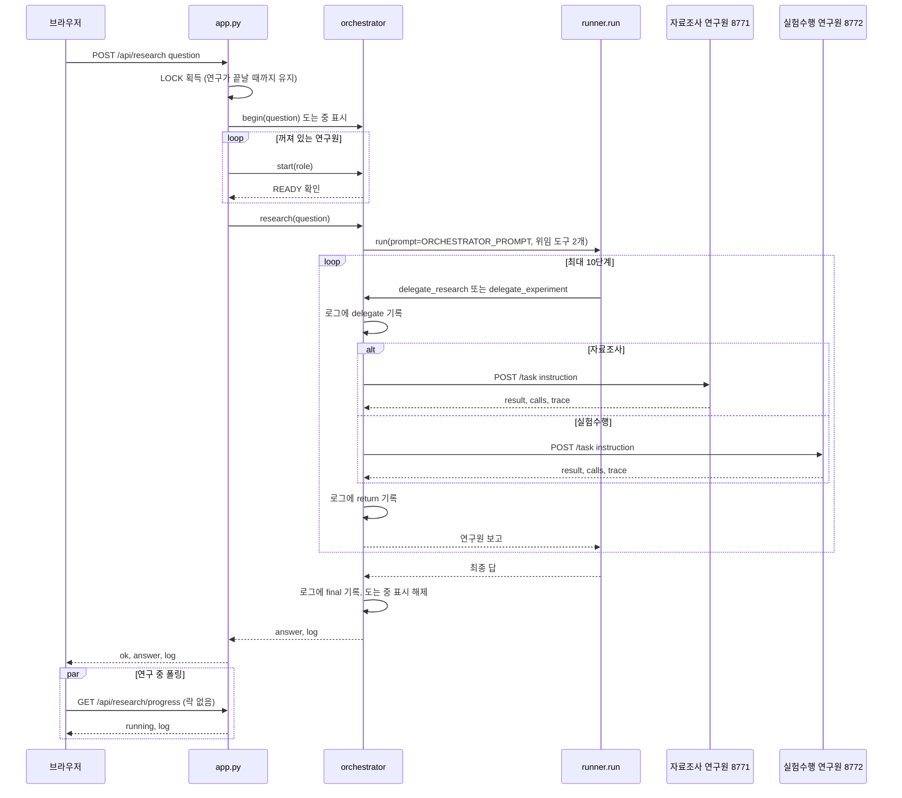
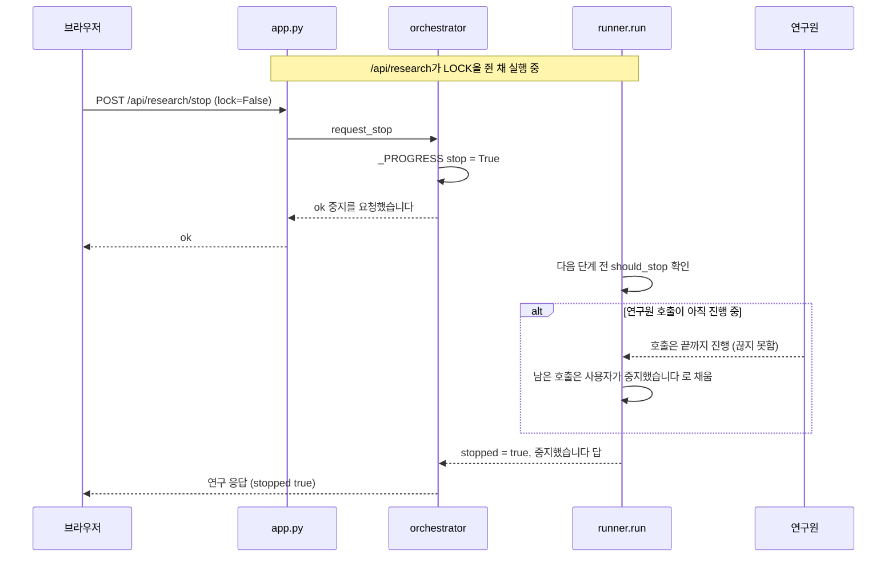
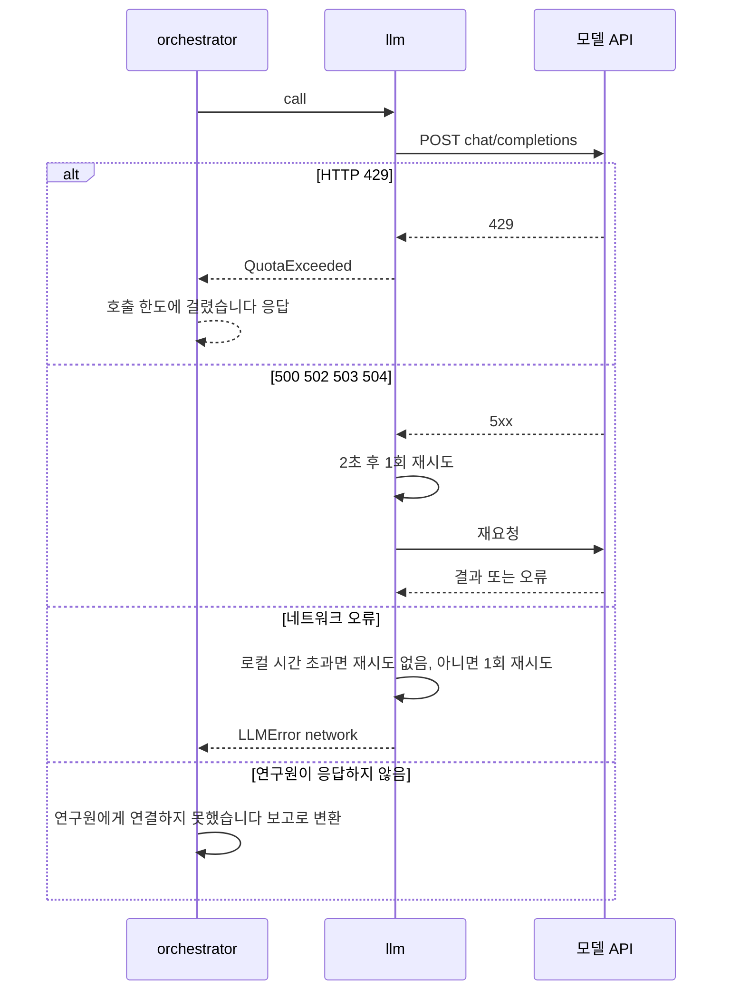
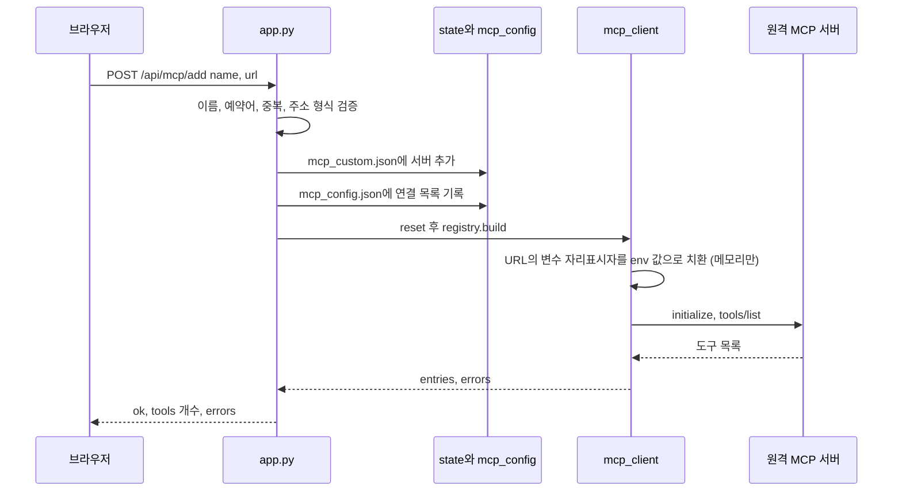
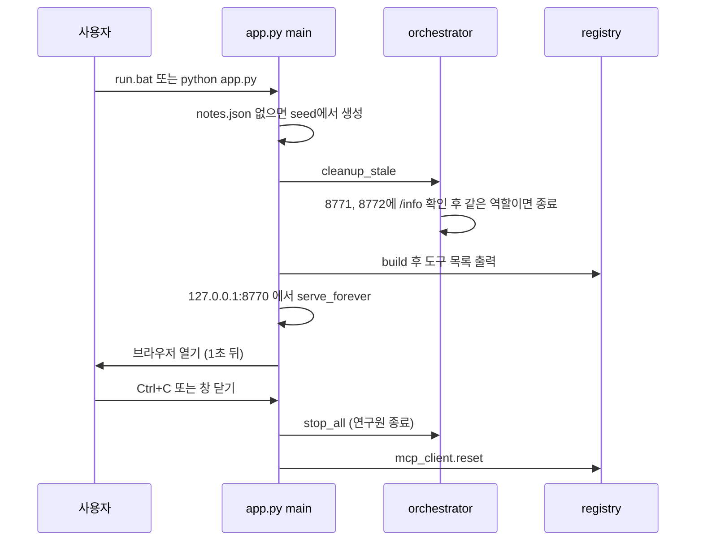
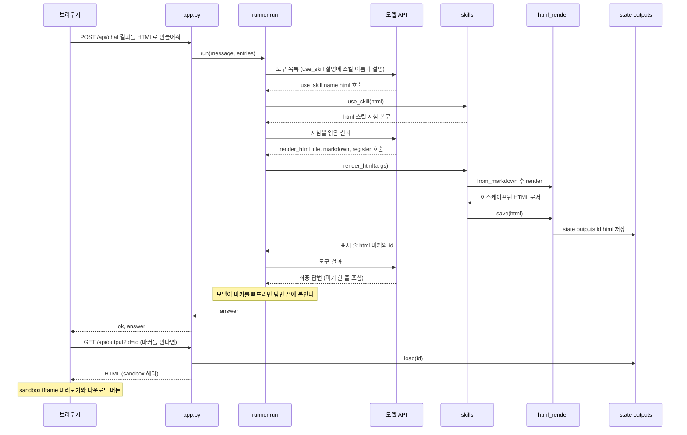
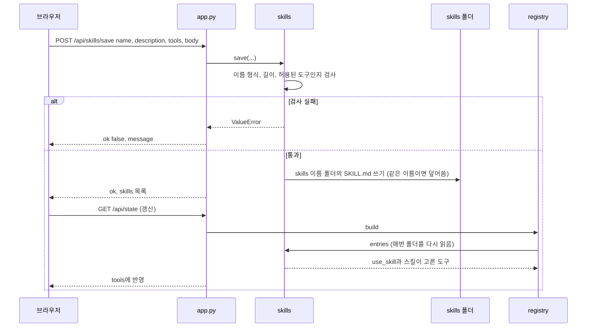

# UML 시퀀스 다이어그램

핵심 흐름을 시나리오별로 정리했다. 구조는 [시스템 아키텍처](system-architecture.md), 경로 명세는 [API 설계](api-design.md)를 본다.

## 1. 요청 검증 · 인증 (모든 요청 공통)

이 앱에는 사용자 계정이 없다. 로그인 대신 **Host/Origin 검사 + 외부 접속 시 Basic 인증**이 인증 역할을 한다.

## 2. 도구 탭 대화 (`POST /api/chat`)

모델은 어떤 도구를 부를지 **결정만** 하고, 실행은 `runner.run()`이 한다.

- 도구가 예외를 던져도 앱은 죽지 않는다. `{"오류": ...}`로 모델에게 돌려줘 재시도하게 한다.
- 모든 `function_call`에는 짝이 되는 `function_call_output`이 있어야 한다. 중지하는 경우에도 채운다.
- 6단계를 다 쓰고도 끝나지 않으면 "요청을 끝내지 못했습니다" 문구로 마친다.

## 3. 연구 요청 (`POST /api/research`) — 핵심 비즈니스 흐름

- 연구책임자는 위임 도구 둘만 가진다. 직접 조사하거나 코드를 짜지 못한다.
- 연구원끼리는 서로를 부를 수단이 없다. 한 연구원의 결과는 연구책임자가 지시문에 담아 다음 연구원에게 전달한다.
- 연구원은 호출 때마다 `roles.prompt_for(role)`로 지침을 읽는다.
- 연구원 호출 한 번의 제한 시간은 600초다.

## 4. 연구 중지와 에러 처리

모델 호출 실패 시의 처리는 다음과 같다.

## 5. 연구원 지침 저장과 반영

```mermaid
sequenceDiagram
    participant B as 브라우저
    participant A as app.py
    participant RO as roles
    participant F as role_prompts.json
    participant EX as 연구원 프로세스

    B->>A: POST /api/agents/prompt role, text (락 없음)
    A->>RO: set_prompt(role, text)
    RO->>RO: 역할, 타입, 길이 검증
    alt 빈 값이거나 기본 지침과 같음
        RO->>F: 해당 역할 키 삭제
        Note right of F: 키가 모두 사라지면 파일 삭제
    else 편집본
        RO->>F: 임시 파일에 쓰고 os.replace
    end
    A-->>B: ok, prompts
    Note over EX: 재시작 없음
    B->>A: POST /api/research (다음 위임)
    A->>EX: POST /task
    EX->>RO: prompt_for(role)
    RO->>F: 매번 읽음
    RO-->>EX: 편집본 또는 기본 지침
```

## 6. MCP 서버 추가 (`POST /api/mcp/add`)

## 7. 앱 기동과 종료

Windows에서 부모 창을 강제로 닫으면 `atexit`이 돌지 않아 자식이 남을 수 있다. 그래서 기동 때 `cleanup_stale`로 한 번 더 정리한다.

## 8. 스킬로 HTML 문서 만들기

오류 흐름: 마크다운이나 형식이 틀리면 `render_html`이 `{"오류": ...}`를 돌려주고 모델이 고쳐 다시 부른다. 에이전트 탭에서는 같은 흐름을 연구책임자가 쓴다(연구원에게는 스킬 도구가 없다).

## 9. 스킬 추가·수정·삭제

앱을 다시 켜지 않아도 다음 요청부터 반영되는 이유는 `registry.build()`가 부를 때마다 스킬 폴더를 새로 읽기 때문이다. 삭제(`/api/skills/delete`)도 같은 방식으로 `SKILL.md`를 지우고 목록을 다시 읽는다.
