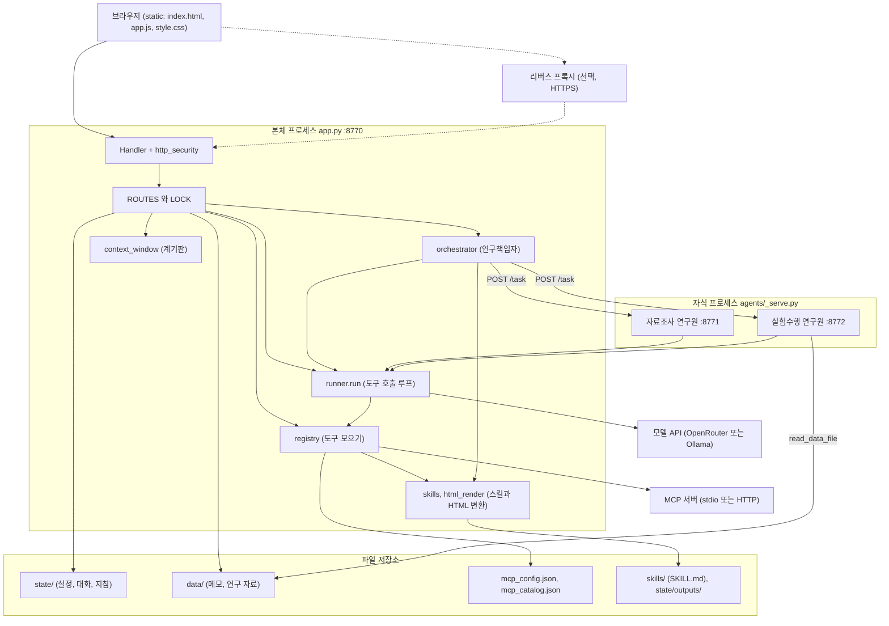
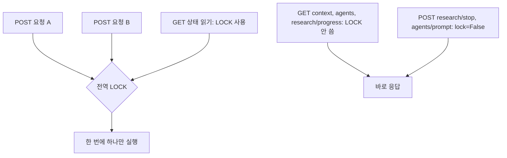
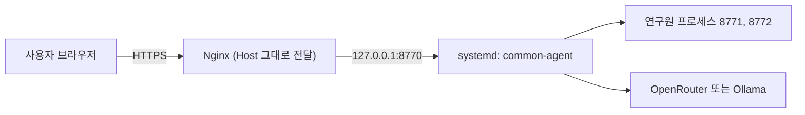

# 시스템 아키텍처 문서

관련 문서: [API 설계](api-design.md) · [시퀀스 다이어그램](sequence-diagrams.md) · [클래스 다이어그램](class-diagram.md) · [데이터 저장소 설계](database-design.md)

## 1. 개요

| 항목 | 내용 |
|------|------|
| 목적 | LLM의 도구 호출(tool use)을 직접 만져 보며 실험하는 로컬 웹 앱. 도구 탭 · MCP 탭 · 에이전트 탭 세 화면 |
| 주요 사용자 | 개인 또는 소규모 팀의 실험자. 한 번에 한 명이 쓰는 것을 전제로 한다 |
| 규모 | 단일 프로세스 + 연구원 자식 프로세스 2개. 동시 사용자 다수를 위한 설계가 아니다 |
| 언어 | UI와 코드 주석, 데이터 모두 한국어 |
| 핵심 제약 | **Python 표준 라이브러리만 사용.** `requirements.txt`도 `pip install` 단계도 없다 |

세 화면의 역할:

1. **도구**: 내장 메모 도구 4개를 모델에 주고 대화한다. 시스템 프롬프트와 모델 제공자를 바꿔 보고, 도구 호출 내역과 Context Window 사용량을 볼 수 있다.
2. **MCP**: 외부 MCP 서버(stdio 또는 Streamable HTTP)를 붙이고, 가져온 도구를 서버 단위·도구 단위로 켜고 끈다.
3. **에이전트**: 연구책임자가 자료조사 연구원과 실험수행 연구원에게 일을 나눠 맡긴다. 연구 자료 파일과 연구원 지침(팝업 편집)을 화면에서 관리한다.

도구 탭에는 **스킬** 카드도 있다. 스킬은 모델이 필요할 때 읽는 지침 글이며, 기본 제공 `html` 스킬은 결과를 HTML 문서로 만든다. 답변 속 HTML 문서는 화면에서 미리보기와 다운로드 버튼으로 나온다.

## 2. 아키텍처 다이어그램

레이어별 역할:

| 레이어 | 모듈 | 역할 |
|--------|------|------|
| 화면 | `static/*` | 프레임워크 없는 HTML·CSS·JS. 빌드 단계 없음 |
| 전송·보안 | `app.py` Handler, `lab/http_security.py` | Host·Origin·Fetch Metadata·JSON·크기 검사, Basic 인증 |
| 업무 흐름 | `app.py`, `lab/orchestrator.py` | 라우트, 연구 실행, 연구원 프로세스 관리 |
| 도구 호출 | `lab/runner.py`, `lab/registry.py`, `lab/llm.py` | 모델 호출과 도구 실행 루프 |
| 도구 | `lab/tools.py`, `lab/datafile.py`, `lab/mcp_client.py`, `lab/skills.py`, `lab/html_render.py` | 내장 메모 도구, 자료 읽기, MCP, 스킬과 HTML 변환 |
| 설정·상태 | `lab/config.py`, `lab/roles.py` | 경로·포트·모델 설정, 역할과 지침 |

## 3. 컴포넌트 설명

| 컴포넌트 | 책임 |
|----------|------|
| `app.py` | 서버 기동, 라우트 등록(`@route`), 상태 조립, 도구 탭 대화 처리 |
| `lab/runner.py` | **모든 곳이 쓰는 단 하나의 도구 호출 루프.** 모델은 무엇을 부를지만 정하고 이 파일이 실행한다 |
| `lab/orchestrator.py` | 자식 프로세스 기동·종료·정리, 위임 도구 생성, 진행 기록, 중지 요청 |
| `agents/_serve.py` | 연구원 한 명을 HTTP 서버로 띄운다. 두 연구원이 같은 코드를 쓰고 역할만 다르다 |
| `lab/roles.py` | 역할(지침, 포트, 도구 종류), 연구원 지침 편집·읽기 |
| `lab/registry.py` | 내장 + MCP 도구를 같은 모양의 항목으로 합친다. 이름이 겹치면 먼저 등록된 쪽 |
| `lab/llm.py` | OpenAI 호환 Chat Completions 호출. 앱 내부 항목 ↔ API 메시지 변환 |
| `lab/mcp_client.py` | stdio·HTTP MCP 클라이언트. `${VAR}` 치환은 연결 순간에만. 원격 서버의 추가 헤더, 도구 인자에 합치는 고정 인자(`fixed_args`), `mcpServers` JSON 읽기 |
| `lab/skills.py` | `skills/<이름>/SKILL.md`를 읽어 `use_skill` 도구와 스킬이 고른 도구(`SKILL_TOOLS`)를 만든다. 화면에서의 추가·수정·삭제. **코드를 실행하지 않는다** |
| `lab/html_render.py` | 마크다운 또는 JSON을 디자인된 HTML 문서로 변환(`ledger`, `dossier`)하고 `state/outputs/`에 저장. 모든 글을 이스케이프한다 |
| `lab/context_window.py` | 추정 후 실측으로 보정하는 사용량 계기판. 추가 API 호출 없음 |
| `lab/datafile.py` | `data/research/`에 한정한 읽기·업로드·삭제 |
| `lab/sandbox.py` | **비활성.** 코드 실행은 항상 거부한다 |

### 3.1 설계 원칙

- **모델은 결정만, 실행은 앱이.** 모든 도구는 `{name, description, parameters, source, call}` 딕셔너리이며 예외는 `{"오류": ...}`로 모델에게 돌려줘 재시도하게 한다.
- **역할 경계는 지침이 아니라 코드로.** 연구책임자는 위임 도구 둘만, 자료조사는 MCP·웹 검색만, 실험수행은 `read_data_file`만 받는다. 연구원끼리는 서로를 부를 수단이 없다.
- **실패해도 앱은 죽지 않는다.** 깨진 상태 파일은 빈 값으로, 연결 실패한 MCP 서버는 건너뛰고 나머지를 쓴다.
- **키는 밖으로 내지 않는다.** `OPENROUTER_API_KEY`는 화면·로그·오류 메시지·상태 응답 어디에도 실리지 않는다.

## 4. 기술 스택 선정 이유

| 선택 | 이유 |
|------|------|
| Python 표준 라이브러리만 | 설치 단계 제거. 어디서든 `python app.py`로 켠다 |
| `http.server` + `ThreadingHTTPServer` | 로컬 단일 사용자 용도에 충분하고 의존성이 없다 |
| 순수 HTML·CSS·JS | 빌드 도구 없이 파일을 고치면 바로 반영된다 |
| JSON 파일 저장 | 데이터가 작고 사람이 열어 보고 고칠 수 있다. DB를 둘 이유가 없다 |
| 연구원을 별도 프로세스로 | 역할 격리와 "서로 직접 통신 없음"을 눈에 보이게 만든다. 프로세스를 켜고 끄는 것이 곧 실험의 일부다 |
| OpenAI 호환 API | OpenRouter와 Ollama를 같은 코드 경로로 지원 |

## 5. 데이터 흐름

- **도구 탭 대화**: 브라우저 → `/api/chat` → `runner.run` → 모델 ↔ 도구 → 대화 기록 저장 → 응답. 이전 턴의 API 항목을 `history`로 이어 넘긴다.
- **연구**: 브라우저 → `/api/research` → 연구책임자 루프 → 연구원 `/task` → (연구원 루프: 모델 ↔ MCP/자료 읽기) → 보고 → 연구책임자가 다음 위임 또는 최종 답. 진행 로그는 메모리에 쌓이고 화면이 `/api/research/progress`로 읽는다.
- **자료**: 화면이 파일을 base64로 보내면(`multipart` 파서를 두지 않으려는 선택) 서버가 `data/research/`에 쓴다. 실험수행 연구원만 `read_data_file`로 읽는다.
- **스킬로 HTML 만들기**: 모델이 `use_skill`로 지침을 읽고 `render_html`에 마크다운을 넘김 → 변환기가 문서를 만들어 `state/outputs/<id>.html`에 저장하고 `[[html:id]]`를 돌려줌 → 답변에 그 표시 줄이 실림 → 화면이 `GET /api/output`으로 받아 sandbox iframe 미리보기와 다운로드 버튼으로 그림. 스킬은 도구 탭 대화와 연구책임자만 쓰고 연구원에게는 주지 않는다.
- **설정**: 화면 → 각 `/api/...` → `state/` 파일. 일부는 읽을 때마다 파일을 다시 본다(연구원 지침, 모델 설정은 수정 시각 비교).

## 6. 동시성 모델

- 본체는 요청마다 스레드를 쓰지만 대부분의 POST는 하나의 `LOCK`으로 직렬화된다. 상태 파일 쓰기가 겹치지 않게 하는 가장 단순한 방법이다.
- `/api/research`는 연구가 끝날 때까지 락을 쥔다. 그 사이에 응답해야 하는 요청은 `lock=False`로 등록한다. **새 라우트를 추가할 때 이 구분을 먼저 정해야 한다.**
- 중지는 협조적이다. 다음 단계를 시작하지 않을 뿐, 이미 보낸 연구원 호출이나 모델 호출은 끊지 못한다.

## 7. 배포 아키텍처

기본은 개발자 PC 한 대에서 `run.bat`/`run.sh`로 켜는 것이다. 서버에 올릴 때는 아래 구성을 쓴다.

- 앱은 항상 `127.0.0.1`에만 바인딩된다. 외부 노출은 같은 서버의 프록시를 통해서만 한다.
- 프록시는 `Host`를 그대로 전달해야 하고, `.env`의 `APP_TRUSTED_ORIGINS`에 공개 주소를, `APP_ACCESS_TOKEN`에 긴 비밀번호를 넣는다. 둘 다 시작할 때 한 번만 읽는다.
- 스크립트: `scripts/deploy/install-service.sh`(systemd), `nginx-site.sh`(프록시), `deploy.sh`(갱신). 자세한 사용법은 `scripts/README.md`.
- 서버에 `state/` 쓰기 권한과 영구 저장 공간이 필요하다. Ollama를 쓰면 **앱 서버에서 접근 가능한 주소**를 입력해야 한다 (`localhost`는 앱 서버 자신).

## 8. 비기능 요구사항

| 영역 | 내용 |
|------|------|
| 보안: 접근 | 루프백 외 접속은 신뢰 origin + Basic 인증 필수. 토큰이 없으면 거부 |
| 보안: 요청 | Host·Origin·`Sec-Fetch-Site`·Content-Type·본문 크기를 모든 POST에서 검사. 연구원 서버는 브라우저 Origin 거부 |
| 보안: 아웃바운드 | Ollama 주소에서 링크로컬(`169.254.x.x`) 거부 — 클라우드 메타데이터 접근 차단 |
| 보안: 비밀값 | API 키는 `.env`에서만 읽고 응답·로그에 싣지 않는다. MCP 키는 `${VAR}`로 적고 메모리에서만 치환 |
| 보안: 파일 | 연구 자료는 `data/research/` 안에서 `basename`만 허용, 확장자 3종, 2MB |
| 보안: 코드 실행 | **금지.** 임포트 필터와 같은 사용자 권한 서브프로세스는 보안 경계가 못 된다. OS 수준 격리(파일시스템·네트워크·자원 제한)가 생기기 전에는 `run_python`을 다시 켜지 않는다 |
| 성능 | 모델 호출 150초(OpenRouter) / 600초(Ollama), 연구원 호출 600초, MCP 요청 20~30초 |
| 한도 | 도구 탭 6단계, 연구책임자 10단계, 연구원 10단계 (한 요청 안의 도구 호출 반복 상한) |
| 확장성 | 단일 사용자 전제. 수평 확장 불가(메모리 세션, 전역 락, 로컬 파일) |
| 복구 | 깨진 JSON은 빈 값으로 취급. 기동 때 지난 실행의 연구원 잔여 프로세스를 정리 |

## 9. 의존성 지도

| 종류 | 대상 | 비고 |
|------|------|------|
| 라이브러리 | 없음 (표준 라이브러리) | `http.server`, `urllib`, `subprocess`, `threading`, `json` 등 |
| 외부 API | OpenRouter | `.env`의 `OPENROUTER_API_KEY` 필요 |
| 외부 API | Ollama (OpenAI 호환 `/v1`) | 도구 호출을 지원하는 모델 필요. 웹 검색 플러그인은 없음 |
| 외부 서비스 | MCP 서버 | 기본 카탈로그 `mslearn`, 기본 연결 `국가법령`(`https://mcp.gomdori.app/law`) 외 사용자가 추가 |
| 런타임 | Python 3.9 이상 | Windows에서는 `py` 런처 또는 번들 Python (`run.bat`이 탐색) |
| 선택 | Nginx, systemd, certbot | 서버 공개 시에만 |
